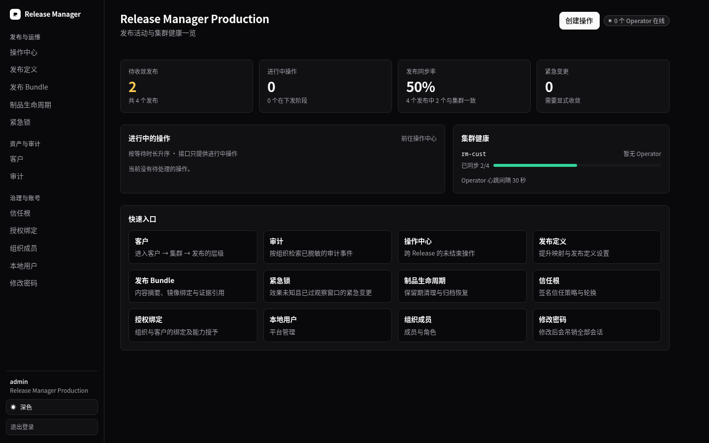
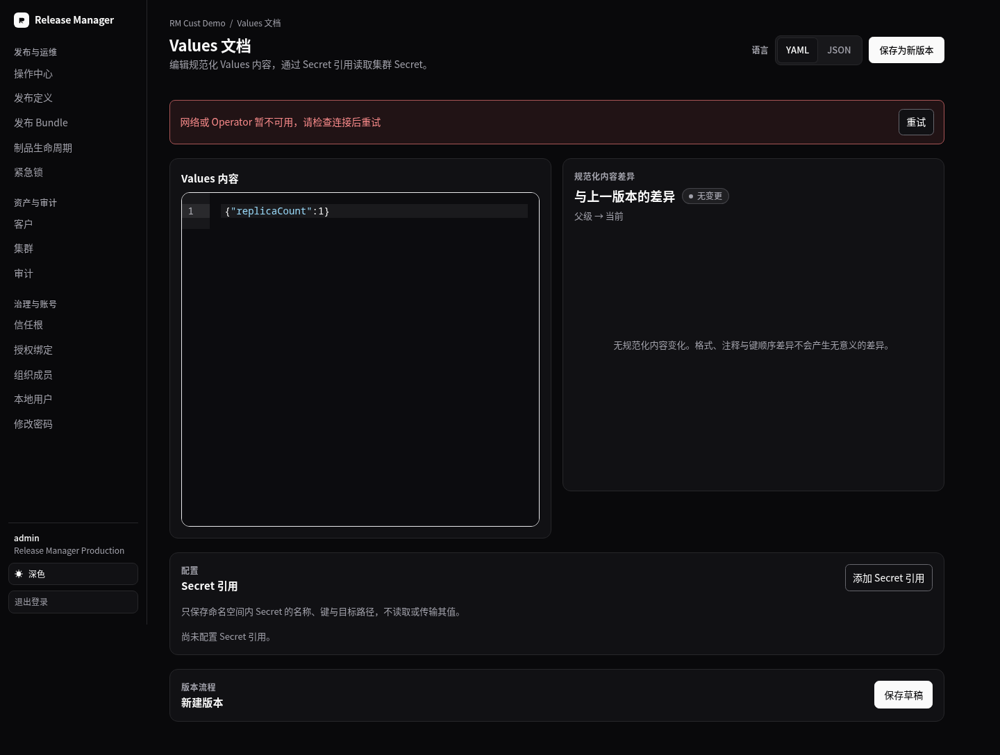
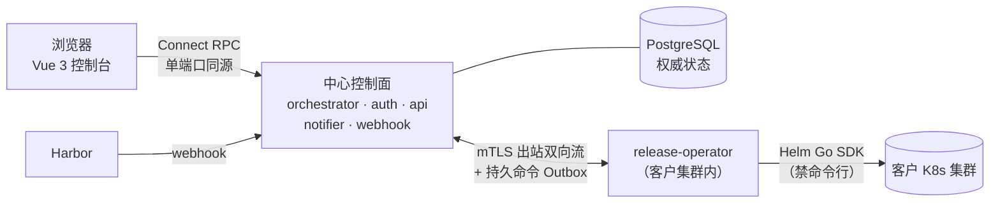

# release-manager

面向**多个 Kubernetes 集群**的 Helm 发布管控面：把「发了什么、发到哪个集群、谁批准的、结果如何、怎么回滚」收敛成一条**可审计、可回滚、可显式收敛**的执行链。

[](https://github.com/ndzuki/release-manager/actions/workflows/test.yml)
[Apache-2.0](LICENSE) · Go 1.27 · Vue 3 控制台 · Connect RPC

| 首页（暗色） | Values 编辑与并排 diff |
| --- | --- |
|  |  |

> 更多界面截图与逐页操作说明见 [`docs/user-manual.md`](docs/user-manual.md)（43 张真实生产截图，含亮色与移动端）。

## 它解决什么问题

当一家平台团队要把自己的产品交付到**几十个客户集群**时，`helm upgrade` 这一步通常长这样：运维从聊天记录里翻出上个月用的 values 文件，用某台跳板机上的 kubeconfig 手工升级，出问题再手工回滚，事后没人能说清「谁在什么时候把这个客户升到了哪个版本」。

`release-manager` 把这条链路产品化：

| 你现在的痛点 | 这个项目的做法 |
| --- | --- |
| 客户集群的 kubeconfig / 凭证散落在多处 | 控制面**不持有**客户集群入站通道与长期 kubeconfig；客户集群里只跑一个 Operator，**出站** mTLS 连回控制面 |
| 「这次升级用的是哪份 values」说不清 | values 是**不可变 Revision**，带审批与并排 diff；Secret 只以引用形式进入执行链 |
| 没有审批、没有审计，谁都能直接改生产 | 审批链 + 独立脱敏审计流水线 + 基于客户绑定的授权快照 |
| 紧急 hotfix 一改就「发完即结束」，线上实际状态无人知道 | 紧急变更必须**显式收敛**：收敛任务、效果未知时的**紧急锁**、卡住锁的人工放行流程 |
| 回滚靠记忆，不知道要退到哪个 revision | Operation 状态机记录每一次安装/升级/回滚，可按 revision 回滚且全程留痕 |
| 集群内执行靠 shell 脚本拼 `helm`/`kubectl` | 集群内执行只走 **Helm Go SDK**（`make sdk-check` 静态门禁拦截命令行路径） |

**它不是** GitOps 同步器（不是 Argo CD / Flux 的替代品），而是**受控发布工作流**：谁批准、发什么、发到哪、怎么回滚、证据在哪。两者可以并存——Argo CD 管集群内持续同步，`release-manager` 管客户交付的审批与执行边界。

## 核心能力

- **发布清单**：按 客户 → 集群 → 命名空间/Release 建立发布清单，持续采集与集群实际状态的同步率与漂移。
- **Values 全生命周期**：不可变 Revision、并排 diff、审批决策、按 Secret 引用渲染（不落明文）。
- **Operation 状态机**：安装 / 升级 / 回滚，CAS + 事务 Outbox，幂等、可重放、可取消（仅 pending/queued 可取消，running 返回 `cancel_not_allowed`）；每一步的阶段条、预检原始 JSON、时间线都在操作详情页。
- **紧急变更与收敛**：受控紧急变更、收敛任务、紧急锁，配合「下次对账回退 / 需异人审批提升」两种收敛策略。
- **制品与 Bundle**：经 Harbor webhook 入口接收制品；Bundle 记录 chart 与镜像集合的内容摘要、来源证据与镜像绑定；制品生命周期支持保留期清理与归档恢复。
- **信任与授权**：签名信任根（信任策略与轮换）、组织↔客户绑定与能力授予、角色（平台管理员 / 发布管理员 / 部署者 / 只读）。
- **审计**：独立、脱敏、异步入库的审计流水线，可按组织检索、归档；**导出能力尚未实现**（只登记 `pending` 记录，现状记录在 [`docs/runbook.md`](docs/runbook.md) §10）。
- **可观测**：每服务 `/readyz` + 结构化 JSON 日志；授权与 workload 身份两条链路暴露 Prometheus `/metrics`（指标面现状见 [`docs/observability.md`](docs/observability.md)）；`make ops-check` 一次只读巡检 21 项（health / pod / 重启 / 备份 / 三份私钥 / schema / 入口 / 缓存头）。

## 架构



**为什么长这样**（完整决策见 [`docs/architecture.md`](docs/architecture.md) 与 [`docs/decisions/`](docs/decisions/)）：

| 约束 | 说明 |
| --- | --- |
| 执行边界 | 控制面不直连目标集群；Operator 出站连接 + 持久命令 Outbox 与本地重放 |
| SDK-only | 集群内执行一律走 Helm Go SDK；`make sdk-check` 静态拦截 `os/exec` 类路径 |
| 单一契约面 | protobuf + Connect；Go/TS 客户端由 `buf` 生成，手写客户端不入库 |
| 数据权威 | 生产 PostgreSQL 单一权威；SQLite 仅 dev/test，**schema 双引擎兼容** |
| 不可变输入 | ValuesRevision 不可变；Secret 只以引用进入执行链 |
| 一致性 | Operation 状态机 CAS + 事务 Outbox；幂等与重放语义显式定义 |
| 审计 | 独立、脱敏、异步入库，支持归档 |
| 紧急变更 | 必须显式收敛，不允许「发完即结束」 |

## 快速开始

前置：Go（版本以 [`go.mod`](go.mod) 为准，当前 `go 1.27.3`）、Docker、k3d、kubectl、`buf`；前端另需 Node（版本见 [`web/package.json`](web/package.json)）。前置检查以 [`deploy/dev/dev.sh`](deploy/dev/dev.sh) 为准。

```bash
make dev-up        # 起 k3d 集群 + 本地 registry + 全部服务（容器）
make dev-seed      # 播种确定性的开发夹具
make dev-status    # 打印状态并写 data/dev-status.json
make ops-check     # 只读巡检 21 项；默认指向仓库记录的验证环境，无集群时 exit 2（可用 RM_KUBE_CONTEXT / RM_BASE_URL 覆盖）
make dev-down      # 删除 5 个受管集群（保留 registry 与镜像缓存）
make dev-purge CONFIRM=1   # 彻底清理（不可逆）
```

控制台（本地 Vite dev server）：

```bash
cd web && npm ci && npm run dev
```

逐服务 `go run` 调试、端口与前置条件见 [`docs/dev-environment.md`](docs/dev-environment.md)。日常排障与生产回滚见 [`docs/runbook.md`](docs/runbook.md)。

## 项目状态（请按此预期使用）

- **公开仓库、Apache-2.0**，处于积极开发中；**尚未发布任何 git tag**，`main` 持续演进（变更按月记录在 [`CHANGELOG.md`](CHANGELOG.md)）。
- 仓库内记录的**验证环境是一个单节点 k3d 集群**（含完整的生产部署记录与回滚步骤，见 [`docs/production-deploy.md`](docs/production-deploy.md)）；**不是托管 SaaS**，也不承诺多集群高可用部署形态。
- 已知缺口（文档如实记录，不隐藏）：客户集群侧 Operator 未接入时，依赖 Operator 的读会**显式降级**（503 + 原因，而不是伪造成功）；Secret **未纳入数据库备份**、证书**没有自动轮换**；这些处置约束见 [`docs/runbook.md`](docs/runbook.md) §11。
- 生产路径的每次变更都要求可复现的验证证据；门禁比功能更能代表项目质量，见 [`docs/testing.md`](docs/testing.md)。

## 参与贡献

欢迎 issue 与 PR。**先开 issue 描述场景**（你想要的发布流程长什么样、卡在哪一步），能显著提高 PR 被接受的概率；小的修复可以直接提 PR。

外部贡献者不需要访问维护者的私有知识库——代码、`docs/` 与门禁即契约：

```bash
make test           # go test -race ./...
make lint           # golangci-lint（0 issues）
make sdk-check      # 禁止命令行的静态门禁
make check-licenses # 依赖许可（只接受 Apache/MIT/BSD/ISC/MPL 等宽松许可）
make check-docs     # 文档事实门禁：写出的 make 目标/路径/链接必须真实存在
make lint-proto     # buf lint
cd web && npm ci && npm test && npm run lint && npm run build
```

上面这些都不需要私有资料。一键聚合用 `ALLOW_NO_REQS=1 make quality` —— 该变量会显式**跳过**三档只对维护者有
意义的门禁（`check-reqs`、`check-tasks`、`check-error-codes`，它们要读维护者的私有知识库文档），其余门禁照常执行；
不设置时这三档会主动 fail（宁可红也不静默跳过）。

提交信息格式 `<type>(<scope>): <summary>`（英文祈使句），正文写清**为什么**改与**怎么验证**；仓库内部提交另带 `(TASK-NNN)` 后缀，外部 PR 可省略。细节与评审关注点见 [`CONTRIBUTING.md`](CONTRIBUTING.md)。

**硬性红线**（违反会被门禁或评审拒绝）：

1. 集群内执行只允许 Helm Go SDK，禁止 `os/exec` / shell 包装；
2. 不手改生成代码（`api/gen/**`、`web/src/gen/**`），要改契约先改 `api/proto/**` 再 `make proto`；
3. 新增表/字段/查询必须同时兼容 SQLite 与 PostgreSQL；
4. 只引入宽松许可依赖（GPL/AGPL/SSPL 等一律拒绝）；
5. `docs/**` 里写的目标、路径、链接、`文件:行号` 都是**可验证断言**——改实现要同步改文档，不许放宽检查绕过。

协作行为约定见 [`CODE_OF_CONDUCT.md`](CODE_OF_CONDUCT.md)，漏洞披露见 [`SECURITY.md`](SECURITY.md)。

## 服务与工具

`cmd/` 下每个目录一个 `package main`。服务构建产物在 `bin/release-*`（Makefile 变量 `SERVICES`）。

| 二进制 | 职责 |
| --- | --- |
| `release-orchestrator` | 发布编排：Operation 生命周期、客户/集群/发布定义、Values、紧急变更 |
| `release-operator` | 客户集群侧 agent：mTLS 双向流、集群内 Helm 执行 |
| `release-auth` | 认证、组织与成员、客户绑定、授权快照 |
| `release-notifier` | 通知投递与死信 |
| `release-api` | 审计查询/归档与只读 API |
| `release-webhook` | Harbor webhook 入口（bundle ingress） |

工具（非长期运行服务）：`devseed`（经正式 API 播种开发夹具）、`e2e`（分阶段 E2E runner）、`imagecheck`（镜像策略校验）、`installgate`（SDK 门禁失败时的限时 quarantine）、`reqcheck`（原子需求模板校验）、`sdkcheck`（SDK-only 静态分析）、`store-migrate`（SQLite → PostgreSQL 一次性迁移）、`notification-sink`（dev-only 通知落点）。

## 仓库结构

```
cmd/          每个二进制的 main 包
internal/     业务实现（对外契约见 internal/store、internal/contracts）
api/proto/    protobuf 单一契约源；api/gen、web/src/gen 为生成产物（禁止手改）
api/kulala/   Kulala/Neovim HTTP 调试集合
configs/      各服务 dev 配置（生产配置由部署侧注入）
deploy/       本地环境（deploy/dev）、kustomize 清单、Dockerfile、夹具
migrations/   PostgreSQL 迁移（golang-migrate，编号连续）
test/         集成测试与分阶段 E2E
web/          Vue 3 + Pinia + Vite 控制台
docs/         架构、手册、运维与 ADR 导出副本
```

## 文档地图

| 文档 | 内容 |
| --- | --- |
| [`docs/user-manual.md`](docs/user-manual.md) | 控制台使用手册：逐页截图 + 操作步骤 + 排错 |
| [`docs/architecture.md`](docs/architecture.md) | 执行边界、服务清单、契约面、数据与一致性 |
| [`docs/dev-environment.md`](docs/dev-environment.md) | 本地环境生命周期、夹具与逐服务调试 |
| [`docs/testing.md`](docs/testing.md) | 单元/集成/E2E 分层、命令矩阵与 CI 关系 |
| [`docs/runbook.md`](docs/runbook.md) | 运维手册：日常巡检、故障定位、发布与镜像级回滚、密钥/证书与备份缺口 |
| [`docs/production-deploy.md`](docs/production-deploy.md) | 生产部署与历次发布记录（含回滚命令与验证口径） |
| [`docs/api.md`](docs/api.md) | Connect 契约面：服务、RPC、认证与错误约定 |
| [`docs/configuration.md`](docs/configuration.md) | 各服务配置键、层级与默认值 |
| [`docs/cli.md`](docs/cli.md) | `cmd/*` 全部可执行文件的 flag、退出码 |
| [`docs/observability.md`](docs/observability.md) | 日志、指标与健康检查 |
| [`docs/glossary.md`](docs/glossary.md) | 领域词汇表（含禁用说法） |
| [`docs/decisions/`](docs/decisions/) | ADR-000 ~ ADR-022（共 23 篇）与索引 |
| [`docs/images/user-manual/README.md`](docs/images/user-manual/README.md) | 截图目录约定（`dc-*` = 当前界面，`legacy/` = 改版前历史证据） |
| [`docs/dependencies.md`](docs/dependencies.md) | 依赖许可清单（生成产物，`make check-licenses` 校验） |
| [`docs/ux-review.md`](docs/ux-review.md) | 控制台交互体验审查与优化清单 |
| [`docs/http-collections.md`](docs/http-collections.md) | `api/kulala/*.http` 调试集合 |
| [`CONTRIBUTING.md`](CONTRIBUTING.md) · [`CODE_OF_CONDUCT.md`](CODE_OF_CONDUCT.md) · [`SECURITY.md`](SECURITY.md) · [`CHANGELOG.md`](CHANGELOG.md) | 贡献、行为准则、漏洞披露、变更记录 |
| [`AGENTS.md`](AGENTS.md) | 面向自动化代理的项目约束 |

目录级说明另有 [`web/README.md`](web/README.md)（前端构建与 feature flag）、[`deploy/README.md`](deploy/README.md)（k3d 与 kustomize 布局）、[`migrations/README.md`](migrations/README.md)（迁移编号与双引擎对齐）、[`test/e2e/README.md`](test/e2e/README.md)（分阶段 E2E runner）。

## 许可

Apache License 2.0，见 [`LICENSE`](LICENSE)。第三方依赖许可证清单见 [`docs/dependencies.md`](docs/dependencies.md)，自带 NOTICE 的上游声明汇总在 [`NOTICE`](NOTICE)。
